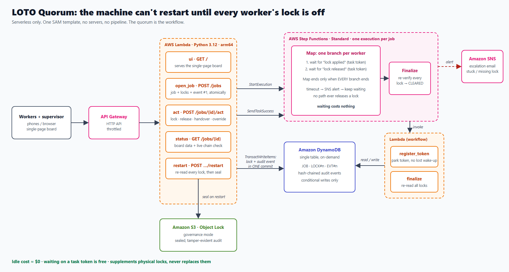

# LOTO Quorum: the machine can't restart until every worker's lock is off

> **Demo video (under 3 minutes):** `https://youtu.be/________`
> **Built for:** AWS Builder Center Weekend Challenge, *No Pipeline, No Problem*
> **Stack:** Lambda · API Gateway · DynamoDB · Step Functions · S3 Object Lock · SNS. One SAM template, no servers, no pipeline.

## The problem
Five technicians are inside a hydraulic press. One finishes, walks out, sees the job board and switches the line back on. Four people are still inside.

Lockout/tagout (LOTO) exists to stop exactly this: each worker puts their own padlock on the energy source, and the machine stays dead until every lock is off. It is also one of the most-broken safety rules in industry: **lockout/tagout ranked 4th among OSHA's most-cited standards in fiscal year 2025, with 2,562 citations** ([source](https://reliamag.com/guides/osha-most-cited-maintenance-violations/), [OSHA top 10](https://osha.gov/top10citedstandards)).

The hard part is not one person and one lock. It's the **group**:
- the crew changes at shift handover
- someone forgets to remove their lock and goes home
- a supervisor has to decide whether it's safe
- and nobody can say who was actually inside, and when

Paper tags and a whiteboard can't answer *"is everyone out?"*

## What LOTO Quorum does
A small serverless app that adds a digital layer to the physical lockout (it never replaces it):
- **Every worker applies their own personal lock** from their phone before entering, and releases it themselves when they're out.
- **The machine is cleared for restart only when every lock is off.** Not most of them. Every one. Any restart attempt before that is refused, and the refusal itself is recorded.
- **Shift handover with no gap:** the outgoing worker hands the lock to the incoming one in a single atomic step, so the lock never comes off. The old link stops working.
- **Stuck locks escalate, they never auto-release:** if a lock stays on too long, or a rostered worker never locks, the supervisor gets an alert. The software can only make a restart harder, never easier.
- **A supervisor override works the way a real procedure does:** a written reason plus an explicit "I verified they are not inside" confirmation, all on the record.
- **Tamper-evident audit:** every action is hash-chained, and the final record is sealed in S3 with Object Lock.

## Watch it run
1. The supervisor locks out *Press Line 4* for Asha, Ben and Chen. Three personal links are issued.
2. All three apply their locks. The board shows **⛔ LOCKED OUT: DO NOT START**.
3. Asha finishes and releases. The supervisor tries to restart: **refused, Ben and Chen still locked**, and that refusal goes in the audit trail.
4. Shift change: Ben hands his lock to Dana. The lock never comes off, and Ben's old link stops working.
5. Chen's lock stays on too long, and the supervisor gets an escalation email. It is *not* released automatically.
6. Dana and Chen release. Step Functions re-verifies and the board turns **✅ CLEARED FOR RESTART**.
7. Restart succeeds. The sealed audit record appears in S3, and the hash chain verifies end to end.

_(Screenshots to add: board LOCKED OUT · restart refused · Step Functions Map execution graph · S3 audit object with Object Lock retention.)_

## How the AWS services connect



| Service | Job |
|---|---|
| **Amazon API Gateway (HTTP API)** | One endpoint for the web app, worker actions, status and restart. Throttled. |
| **AWS Lambda** (Python 3.12, arm64, no dependencies) | Seven small handlers: open job, act, status, restart, serve UI, park task token, finalize |
| **AWS Step Functions (Standard)** | **The quorum *is* the workflow.** A `Map` runs one branch per worker. Each branch pauses on a task token for "lock applied", then for "lock released". The Map finishes only when every branch finishes. Timeouts route to an SNS alert and loop back; there is no path that releases a lock. |
| **Amazon DynamoDB** (on-demand, single table) | Job, one item per lock, and the audit events. Every lock change and its audit event commit **together** in one `TransactWriteItems`, guarded by condition expressions. |
| **Amazon SNS** | Escalations for a missing or stuck lock (direct Step Functions integration, no Lambda) |
| **Amazon S3 (Object Lock, governance mode)** | The sealed, tamper-evident audit record for each job |

### Three details that make it reliable
1. **Defence in depth.** The "every lock is off" rule is enforced three times:
   - by the Map's structure
   - by DynamoDB conditions (a lock can only go `AWAITING → LOCKED → RELEASED`, and only with the current holder's key)
   - by the restart function, which re-reads every lock before allowing a restart

   Any failed check leaves the machine **locked out**: the system fails safe.
2. **No lost wake-ups.** When a branch starts waiting, `register_token` parks its task token on the lock item and, in the same atomic update, checks whether the awaited condition is already true. If a worker tapped while an old token was timing out, the workflow resumes anyway. Repeat taps are idempotent.
3. **Hash-chained audit under concurrency.** Each event stores `sha256(previous hash + event)`. The job's sequence number is advanced with an optimistic-concurrency condition inside the same transaction. Simultaneous taps therefore can't fork the chain or lose an event. The board re-verifies the chain live.

## Proof it runs
- `tests/test_rules.py`: **10/10 offline checks passed.** Hash chain (edit, delete, reorder and truncate are all detected), the wake-up truth table, and the legal lock transitions.
- `scripts/smoke_test.py` runs against the deployed stack: **40/40 checks passed.** It covers:
  - refusals before and during work
  - wrong-key and wrong-supervisor rejection
  - shift handover with no gap
  - supervisor override with reason and confirmation
  - 8 workers locking and releasing at the same instant, with zero lost or duplicated events (sequence = 18 exactly)
  - chain verification (server side and independently on the client)
  - an S3 seal on restart
  - with `--escalation`: a stuck lock raises both SNS alert states and **stays locked**

## Deploy it (one template, no build step, no pipeline)
```bash
sam deploy --guided                      # first time; or:
sam deploy --profile <profile> --region <region> --resolve-s3
```
Open the `AppUrl` output. Optional parameters: `AlertEmail` (confirm the SNS subscription), `SiteCode` (required to open a lockout), `AuditRetentionDays`.

```bash
python tests/test_rules.py                                   # offline
python scripts/smoke_test.py <AppUrl> --escalation --profile <profile> --region <region>
python scripts/demo_job.py <AppUrl> --prelock Asha           # open a ready-to-use demo lockout and print every link
```

## Reuse the pattern
The reusable core is an **N-of-N human quorum gate**: a Step Functions Map of task-token waits plus a conditional-write state machine in DynamoDB. Anywhere "everyone must sign off before X happens" it works unchanged:
- two-person rule approvals
- change freezes
- clean-room or lab access
- aircraft maintenance sign-off
- data-centre hands-on work

Swap the roster and the final step.

## Scales to zero
- **No servers or containers, nothing to patch.** Every service is pay-per-use.
- **Waiting is free:** a Standard workflow can wait on a task token for an 8-hour shift (or up to a year) at no compute cost. A 5-worker job is roughly 20 state transitions, a fraction of a cent.
- **Idle cost:** ≈ $0.

## Limitations and safety
- LOTO Quorum is a **supplement** to physical locks and a site's written energy-control procedure, **never a replacement**.
- **Sign-in:** access uses unguessable per-worker links (the key travels in the URL fragment, never in server logs). Production would add Amazon Cognito and site roles.
- **Roster:** fixed when the job opens; changes happen via handover or supervisor override. A lock is single-use per job: once released it cannot be re-applied, and anyone who must re-enter needs a new lockout. This is deliberate, so no lock can appear after the machine is cleared.
- **No machine control:** restart permission is recorded, not wired to a PLC. Any integration should only ever *block* energisation.
- **Connectivity:** if the network is down, the physical procedure is the source of truth.
- **Audit retention:** governance-mode Object Lock for `AuditRetentionDays` (default 1 day, so the demo stack can be deleted). Raise it, or use compliance mode, for real use.

_Built as a personal project for the AWS Builder Center Weekend Challenge: No Pipeline, No Problem._
